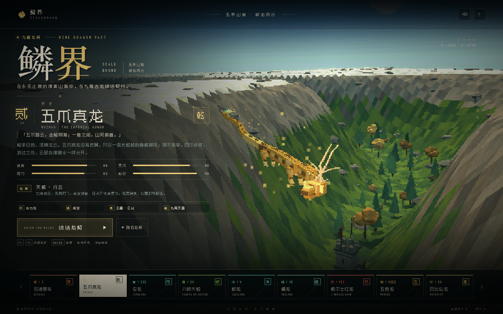
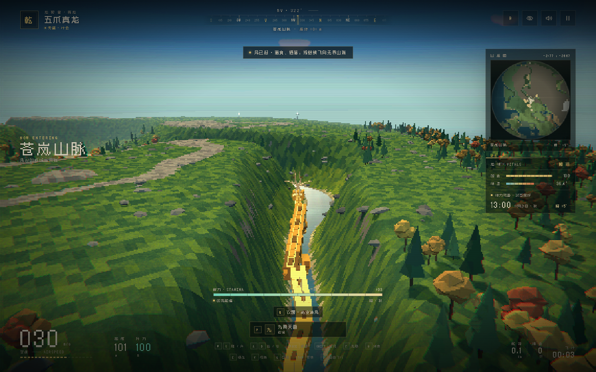

# 鳞界 · SCALEBOUND

一款无外部素材依赖的像素风 3D 飞龙游戏。九条龙、无限山海、程序化生成的地形与音景，全部装在一个可直接双击打开的 HTML 文件里。

## 直接游玩

打开根目录的 **`scalebound.html`**。这是完整的离线单文件版（约 2 MB），字体、着色器、贴图和音频全部内联，不需要服务器，也没有任何外部资源请求。

也可以启动开发服务器：

```bash
npm install
npm run dev        # http://127.0.0.1:5198/
npm run build      # 生产构建到 dist/
npm run standalone # 重新生成单文件 scalebound.html
```

## 九曜龙契

| # | 龙 | 设计线索 | 飞行特性 |
|---|----|----------|----------|
| 壹 | 黑王尼德霍格 | 枯骨、残翼、余烬与深渊黑紫 | 俯冲极快，振翅沉重 |
| 贰 | 五爪真龙 | 鎏金鳞、五爪、长须、帝王气 | 升力平稳，风环祝福更久 |
| 叁 | 应龙 | 青玉翼羽、云雨之神 | 升力更高，湖海上回气更快 |
| 肆 | 拉冬 | 三首、金苹果园、翠绿鳞羽 | 振翅省力，体力恢复最快 |
| 伍 | 蛟龙 | 江涛青蓝、鳍翼、鳄吻 | 贴水疾行，水域如归 |
| 陆 | 璃龙 | 透白琉璃、晶翼折射 | 转向最灵，翼若碎光 |
| 柒 | 威尔士红龙 | 赤红厚鳞、羊角、宽膜翼 | 疾风更猛，俯冲更快 |
| 捌 | 五色龙 | 五彩冠角、彩羽、虹光 | 龙魂牵引范围更大，回气均衡 |
| 玖 | 巴比伦龙 | 青金石与黄金、怒目、王冠 | 升力更强，风环祝福更久 |

所有龙共用同一套低多边形/体素材质语言与程序化骨架，但头冠、角、须、翼型、尾鳍、体色与飞行参数分别设计。

## 操作

| 按键 | 操作 |
|------|------|
| `W` / `↑` | 抬头爬升 |
| `S` / `↓` | 低头俯冲 |
| `A` / `←` | 左转 |
| `D` / `→` | 右转 |
| `Space` | 振翅（消耗体力，获得升力） |
| `Shift` | 疾风冲刺 |
| `Ctrl` | 收翼减速 |
| `F` | 龙吼 |
| `V` | 切换追尾 / 电影视角 |
| `R` | 回到安全高度 |
| `M` | 声音开关 |
| `H` | 飞行手册 |
| `Esc` | 暂栖 / 返回 |

菜单中：`← →` 切换龙契，`Enter` 启程，`R` 随机龙契。飞行中按住右键拖动可环视。

## 玩法

循着金色龙魂光柱飞行，穿过金色风环。龙魂会累积「龙威」，每九枚触发一次九曜共鸣；风环回复体力并给予短暂的速度祝福。地图没有边界，可以一直飞向新的山脉、河谷、湖泊与远海。

首次点击或按键后，程序化音景才会开启。

## 技术

- Vite + Three.js，原生 ES modules。
- 低分辨率 WebGL 渲染目标（约 340–380p）后处理上采样，配合 Bayer 抖动、调色板量化、色差、暗角和像素扫描线。
- 分块无限地形：种子噪声、山脊/河谷/海面、逐块实例化植被与巨岩、自定义地形颗粒 shader。
- 程序化龙模型：体素骨架、蝠翼 / 羽翼 / 鳍翼 / 飘带 / 晶翼，九套配色与头冠，几何合并降低 draw call。
- 程序化飞行动画：锁相振翅、尾部波动、头颈稳定、收腿、眨眼、龙吼。
- 轻量气动物理：推力/阻力、失速、俯冲增速、贴水滑翔、地形碰撞与镜头反馈。
- 程序化 WebAudio：风声、氛围铺底、拨弦、振翅、龙吼、拾取与 UI 音效。

## 截图






`screenshots/` 中保留了当前版本的展示图；`scalebound.html` 已在 Chrome 中以 `file://` 方式实测启动，无外部网络请求，控制台无报错。
