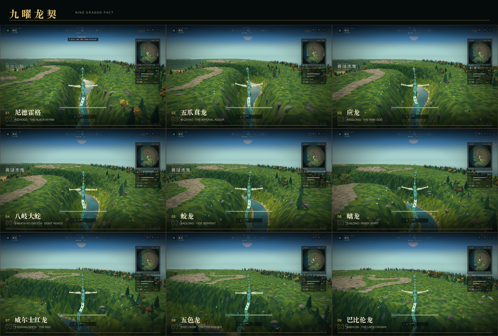

# 鳞界 2.2 · SCALEBOUND

一款可直接在浏览器中游玩的 **像素风 3D 御龙游戏**。九条古龙、无限山海、真实时间、四季天气、可潜水与燃烧的战场。

> **正式版**：**[scalebound.html](scalebound.html)**（约 2.3 MB，双击即可游玩）
>
> **Beta 前瞻版**：**[scalebound-beta.html](scalebound-beta.html)**（独立文件；自动飞行、龙群 AI、九头海德拉/提亚马特、死亡动画与空战均标 `BETA`，稳定版不会误触发）
>
> **中国版 C**：**[scalebound-cn.html](scalebound-cn.html)**（标准规则特别衍生；八条中国龙、国画水墨渲染）
>
> GitHub：`https://github.com/Leica-Shen/scalebound`（私有仓库）

## 运行

```bash
npm install
npm run dev        # 本地开发：http://127.0.0.1:5198/
npm run build      # 生产构建到 dist/
npm run standalone # 生成标准版、Beta 前瞻版和中国版 C 三个文件
```

浏览器需支持 WebGL2（Chrome / Edge / Safari 现代版本）。首次点击或按键后开启程序化音景。

## 九曜龙契

| # | 古龙 | 形态 | 专属恢复 | 捕食 / 特殊进食 | 龙赋（F） |
|---|------|------|----------|------------------|-----------|
| 壹 | 黑王尼德霍格 | 西方・残翼巨龙 | 地面栖伏，夜间更快 | 岩羊、飞鸟 | 冥焰吐息 |
| 贰 | 五爪真龙 | 东方・云霓长龙 | 高空滑翔、日光栖地 | 高空饮露 | 九霄天雷 |
| 叁 | 应龙 | 东方・羽翼雨神 | 湖海浮息、雨中更快 | 游鱼、飞鸟 | 兴云布雨 |
| 肆 | 八岐大蛇 | 东方・八首蛇神 | 浅水、林间、雨中 | 岩羊、飞鸟、游鱼 | 八岐瘴气 |
| 伍 | 蛟龙 | 东方・江涛龙 | 海面 / 深水浮息 | 游鱼 | 翻江倒海 |
| 陆 | 螭龙 | 东方・无角江龙 | 水面、雨中、浅水 | 游鱼、飞鸟 | 寒江螭影 |
| 柒 | 威尔士红龙 | 西方・赤鳞巨龙 | 地面或火边歇息 | 岩羊、飞鸟 | 赤焰龙息 |
| 捌 | 五色龙 | 东方・五行虹龙 | 全地形适应 | 游鱼、飞鸟、岩羊 | 五行轮转 |
| 玖 | 巴比伦龙 | 蛇翼・青金石王龙 | 高空日光下恢复 | 岩羊、飞鸟 | 星陨天罚 |

九条龙共享一套程序化骨架与低多边形材质语言，但 **东方龙**（长躯、无巨翼/云带/羽鬣、收爪）、**西方龙**（厚躯、四足、蝠翼/羽翼）与 **蛇翼龙** 在比例、翼型、角冠、须鬣、尾鳍、腿型与飞行参数上分别设计。每条龙的体力上限由耐力计算，速度、转向、升力、俯冲、振翅消耗与恢复速度均不相同。

## 操作

| 输入 | 动作 |
|------|------|
| `W` / `S` 或 `↑` / `↓` | 俯冲 / 爬升（默认方向互调；`G` 恢复标准） |
| `A` / `D` 或 `←` / `→` | 右转 / 左转（默认方向互调） |
| 左键按住拖动（鼠标 / 触控板） | 操控飞行：默认向右拖 = 左转，向上拖 = 抬升 |
| 滚轮 / 触控板双指滚动 | 镜头缩放 |
| `G` | 方向互调开关（同时作用于 W/S、A/D 与鼠标左右） |
| `TAB` | 聚焦视野：隐藏地图、生机面板与控制提示 |
| `SPACE` | 振翅（消耗体力，获得升力） |
| `SHIFT` | 疾风冲刺 |
| `CTRL` | 收翼减速 |
| `E` | 降落 / 起飞 / 浮出水面 |
| `Q` | 捕食 / 饮水 / 饮露 / 凝月 / 觅果 |
| `F` | 释放龙赋（龙炎、雷雨、八岐瘴气、冰霜、星陨……） |
| `V` | 追随 → 龙背 → 自由 360° → 电影 |
| 右键拖拽 | 追随镜头环视 |
| `R` | 回到安全高度 |
| `M` / `H` | 声音 / 飞行手册 |
| `ESC` | 暂停 / 返回龙契 |
| **Beta** `B` / `X` | 自动飞行（巡航 / 捕食 / 休整） / 抓咬最近的非玩家龙 |

菜单：`←` `→` 切换龙契，`Enter` 启程；**按住左键拖拽可 360° 环视龙身，滚轮缩放**。默认方向互调可在菜单或飞行中按 `G` 关闭。

## 世界

- **真实时间与四季**：游戏时钟读取本机时间，太阳角度、月光、日照色温、气温随钟点变化；月份决定春/夏/秋/冬，树冠、草地、地表积雪同步变化。
- **天气**：晴、多云、雨、雷暴、雪、雾；有雨线和雪粒子、雷电闪光、风场、雾距与云量变化；火场会被雨浇灭。
- **温度与饱食**：外部气温受季节、昼夜、海拔、天气与水域影响；龙体体温会随环境变化。饥饿与失温会拖慢体力恢复，火边、日光、雪夜与深水都有不同作用。
- **野生生态**：游鱼在水下成群游弋，海鸟在空中结群盘旋，岩羊在草坡上觅食；它们会因巨龙接近或火场而逃散。不同龙种可捕食不同猎物。
- **人造遗迹**：程序化生成的石塔、门阙与石堡废墟，清理出林间空地，塔顶有旗与烟。
- **可改变地形**：星陨砸出环形山，藤蔓隆起土丘，潮汐冲出洼地，冰霜冻结水面，雷击烧焦大地。
- **地面火场**：龙炎会点燃**树木树冠与草地**，树木焦化、树冠起火并冒烟，火势会扩散；雨与水系龙赋可将其熄灭。
- **潜水与水色**：应龙、蛟龙与八岐大蛇可潜到海床，镜头与雾色进入水下状态，有提亮的水下光、焦散纹、气泡与游鱼；水面会自动让出视野。
- **镜头**：追随镜头、背上的御龙视角、无约束自由环绕、电影机位；所有视角都支持缩放与鼠标/触控板。
- **程序化音景**：风、弦、拨弦、振翅、龙吼、拾取与UI音效全部由 WebAudio 实时合成，无外部音频文件。

## 技术

- Vite + Three.js，原生 ES modules，无外部运行时素材。
- 340–380p 低分辨率渲染 + Bayer 抖动、调色板量化、色差、扫描线、暗角与像素化上采样。
- 分块无限地形、程序化山脉/河谷/湖泊/海面、季节着色器、实例化植被/草簇/岩石、树木风场与接触阴影；方向光实时阴影。
- 程序化龙骨架、九套形态与材质，锁相振翅/尾涌/头颈稳定/收腿/眨眼/咆哮/栖落与游动姿态。
- 轻量气动物理：失速、俯冲增速、贴水、地形碰撞、降落、潜游。
- 程序化鱼群/鸟群/羊群 AI、石塔生成、树木焚烧与地形编辑；Beta 另含非玩家龙 AI 与空战。
- 单 HTML 内联构建（字体、样式、脚本、着色器全部内联）。

## 中国版 C · 山河龙谱

`scalebound-cn.html` 是标准版的特别衍生，不包含 Beta 实验系统：

- **八龙图**：应龙、青龙、敖广、黄龙、睚眦、螭龙、虬龙、天龙；各自的角冠、须鬣、鳍翼、鳞色、龙赋与飞行参数独立配置。
- **国画渲染**：暖纸色天空、矿物水墨调色、SOBEL 笔触边缘、纸纹与留白、宋体题签与朱砂印记；保留 3D 以维持原玩法与透视层次。
- **中国式构图与配色**：较平的视场、长焦层次、雾中远山、青绿与赭石相间；龙体更长、更飘，须鬣与尾鳍强调书法运笔。
- **独立文件**：中国版与标准版的存档设置与入口互不混用；同一套世界、生存与操控规则。

## Beta 前瞻版

`scalebound-beta.html` 与正式版共用世界与九龙，但额外开放以下标有 `BETA` 的系统，正式版保持关闭：

- **自动飞行**：按 `B` 开启。龙会自行巡游、寻找猎物进食、体力不足时寻找栖地休息，恢复后再次起飞；遭遇敌对龙时会自动接战。
- **非玩家龙 AI**：世界中随机生成 4 条非玩家龙，具有巡逻、捕食、休整、追逐、逃离与互相冲突状态；同一场景不会重复龙种，并会按概率出现九头海德拉与提亚马特。
- **空战与死亡**：`X` 抓咬最近的敌对龙，`F` 龙赋会造成范围伤害；敌对龙会反击，死亡时旋转坠落并在烟尘中消散。HUD、手册与自动飞行按钮均带 Beta 标识。
- **自动战斗**：自动模式在遭遇时会主动转向、抓咬并在安全距离释放龙赋。
- **隔离承诺**：Beta 系统仅在独立文件中启用，正式版不加载对手龙、不启用自动飞行/空战；这些设计将在下一版本评估后再并入正式版。

## 验证

已在 Chrome 中通过 `file://` 启动标准版、Beta 前瞻版和中国版 C：无外部网络请求、控制台无错误；九龙切换（含八岐大蛇八首与螭龙）、方向互调（G）、聚焦视野（TAB）、起飞/栖落、海面浮停、潜水/浮出、捕食、龙赋、树木点燃与焦化、自动飞行、非玩家龙生成/去重/死亡动画、九头海德拉生成与空中冲突、中国版八龙与水墨渲染均通过。正式版不会启用 Beta 系统。

## 截图



- [主界面](screenshots/final-menu.png)
- [御龙飞行](screenshots/final-flight.png)
- [Beta 对战](screenshots/final-beta.png)
- [燃烧森林](screenshots/final-treefire.png)
- [中国版 C](screenshots/final-cn-menu.png)
- [中国版飞行](screenshots/final-cn-flight.png)
- [中国版八龙图](screenshots/final-cn-dragons.png)
- [水下](screenshots/final-underwater.png)
- [雪季](screenshots/final-winter.png)
- [石塔遗迹](screenshots/final-structure.png)
- [岩羊群](screenshots/final-wildlife.png)

所有画面均为程序化场景，实时生成；截图为方便展示固定了指定时刻，实际游戏默认跟随本机时间。

---

**鳞界制作组** · SCALEBOUND
